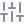
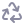
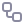

# EakUI Icons

EakUI ships **176 built-in icons** that you can use by name anywhere an image is accepted.

```lua
Window:Tab({ Title = "Settings", Icon = "settings" })
Tab:Button({ Title = "Teleport", Icon = "map-pin" })
Tab:Toggle({ Title = "God Mode", Icon = "shield" })
UI:Notify({ Title = "Saved", Icon = "check-circle" })
```

## How it works

- Icons are white line icons on a 24px grid (Lucide style). Element and tab icons are tinted by the theme automatically.
- The first time an icon is used, it is downloaded from this repository into `workspace/EakUI/assets/` and reused after that.
- This needs an executor with `writefile` and `getcustomasset`, which is the same requirement as URL images.
- Asset IDs (`rbxassetid://...`), URLs and workspace files still work exactly as before.
- `UI:GetIcons()` returns every name grouped by category.
- `UI:SetIconBaseUrl(url)` loads icons from your own host instead of this repository.
- `UI:Preload({ "settings", "sword" })` downloads icons ahead of time so they appear instantly.

## Names are case-insensitive

`"Settings"`, `"settings"` and `"SETTINGS"` all work. Spaces and underscores become dashes, so `"map pin"` and `"map_pin"` both resolve to `"map-pin"`.

## Icons

### Interface (19)

|   |   |   |   |   |   |
|---|---|---|---|---|---|
| <br>`home` | <br>`settings` | <br>`sliders` | <br>`menu` | <br>`search` | <br>`x` |
| <br>`check` | <br>`plus` | <br>`minus` | <br>`chevron-right` | <br>`chevron-down` | <br>`arrow-left` |
| <br>`arrow-right` | <br>`external-link` | <br>`refresh` | <br>`filter` | <br>`grid` | <br>`list` |
| <br>`more` |   |   |   |   |   |

### User & Security (14)

|   |   |   |   |   |   |
|---|---|---|---|---|---|
| <br>`user` | <br>`users` | <br>`user-plus` | <br>`crown` | <br>`shield` | <br>`shield-check` |
| <br>`lock` | <br>`unlock` | <br>`key` | <br>`eye` | <br>`eye-off` | <br>`bell` |
| <br>`star` | <br>`heart` |   |   |   |   |

### Combat & Game (13)

|   |   |   |   |   |   |
|---|---|---|---|---|---|
| <br>`sword` | <br>`crosshair` | <br>`target` | <br>`zap` | <br>`flame` | <br>`skull` |
| <br>`bomb` | <br>`trophy` | <br>`gem` | <br>`coins` | <br>`gift` | <br>`package` |
| <br>`rocket` |   |   |   |   |   |

### World & Movement (9)

|   |   |   |   |   |   |
|---|---|---|---|---|---|
| <br>`map` | <br>`map-pin` | <br>`compass` | <br>`navigation` | <br>`globe` | <br>`mountain` |
| <br>`sun` | <br>`moon` | <br>`cloud` |   |   |   |

### Actions (14)

|   |   |   |   |   |   |
|---|---|---|---|---|---|
| <br>`play` | <br>`pause` | <br>`stop` | <br>`save` | <br>`download` | <br>`upload` |
| <br>`trash` | <br>`copy` | <br>`edit` | <br>`send` | <br>`link` | <br>`log-out` |
| <br>`power` | <br>`undo` |   |   |   |   |

### Info & System (22)

|   |   |   |   |   |   |
|---|---|---|---|---|---|
| <br>`info` | <br>`alert` | <br>`help` | <br>`check-circle` | <br>`x-circle` | <br>`clock` |
| <br>`calendar` | <br>`bar-chart` | <br>`activity` | <br>`terminal` | <br>`code` | <br>`cpu` |
| <br>`wifi` | <br>`monitor` | <br>`smartphone` | <br>`keyboard` | <br>`mouse-pointer` | <br>`camera` |
| <br>`image` | <br>`music` | <br>`volume` | <br>`message` |   |   |

### Farming & Harvest (22)

|   |   |   |   |   |   |
|---|---|---|---|---|---|
| <br>`sprout` | <br>`leaf` | <br>`wheat` | <br>`tree` | <br>`tree-round` | <br>`flower` |
| <br>`seed` | <br>`shovel` | <br>`watering-can` | <br>`droplet` | <br>`apple` | <br>`carrot` |
| <br>`grape` | <br>`cherry` | <br>`egg` | <br>`fish` | <br>`fishing-rod` | <br>`bug` |
| <br>`paw` | <br>`barn` | <br>`tractor` | <br>`basket` |   |   |

### Tools & Gathering (9)

|   |   |   |   |   |   |
|---|---|---|---|---|---|
| <br>`axe` | <br>`pickaxe` | <br>`hammer` | <br>`wrench` | <br>`magnet` | <br>`hand` |
| <br>`recycle` | <br>`bag` | <br>`backpack` |   |   |   |

### Automation (14)

|   |   |   |   |   |   |
|---|---|---|---|---|---|
| <br>`bot` | <br>`repeat` | <br>`timer` | <br>`hourglass` | <br>`workflow` | <br>`infinity` |
| <br>`route` | <br>`radar` | <br>`scan` | <br>`fast-forward` | <br>`skip-forward` | <br>`toggle` |
| <br>`trending-up` | <br>`layers` |   |   |   |   |

### Economy & Items (10)

|   |   |   |   |   |   |
|---|---|---|---|---|---|
| <br>`cart` | <br>`store` | <br>`wallet` | <br>`dollar` | <br>`archive` | <br>`diamond` |
| <br>`potion` | <br>`scroll` | <br>`flag` | <br>`anchor` |   |   |

### Blocks & Building (14)

|   |   |   |   |   |   |
|---|---|---|---|---|---|
| <br>`block` | <br>`blocks` | <br>`brick` | <br>`block-break` | <br>`block-place` | <br>`block-remove` |
| <br>`door` | <br>`ladder` | <br>`chest` | <br>`sign` | <br>`portal` | <br>`fence` |
| <br>`platform` | <br>`seed-pack` |   |   |   |   |

### Player & Movement (16)

|   |   |   |   |   |   |
|---|---|---|---|---|---|
| <br>`player` | <br>`player-run` | <br>`jump` | <br>`move` | <br>`move-vertical` | <br>`move-horizontal` |
| <br>`rotate` | <br>`teleport` | <br>`fly` | <br>`footprints` | <br>`spawn` | <br>`punch` |
| <br>`swim` | <br>`ghost` | <br>`speed` | <br>`health` |   |   |

## Aliases

Common alternative names map to the icons above:

| Alias | Icon |
|---|---|
| `aim` | `crosshair` |
| `alert-triangle` | `alert` |
| `auto` | `bot` |
| `break` | `block-break` |
| `build` | `block-place` |
| `cash` | `dollar` |
| `character` | `player` |
| `chart` | `bar-chart` |
| `chat` | `message` |
| `chop` | `axe` |
| `close` | `x` |
| `cog` | `settings` |
| `crop` | `wheat` |
| `cube` | `block` |
| `ellipsis` | `more` |
| `exit` | `log-out` |
| `farm` | `sprout` |
| `fire` | `flame` |
| `flash` | `zap` |
| `gear` | `settings` |
| `hamburger` | `menu` |
| `harvest` | `wheat` |
| `help-circle` | `help` |
| `home-2` | `home` |
| `house` | `home` |
| `inventory` | `backpack` |
| `lightning` | `zap` |
| `location` | `map-pin` |
| `loop` | `repeat` |
| `mine` | `pickaxe` |
| `money` | `dollar` |
| `pc` | `monitor` |
| `pencil` | `edit` |
| `phone` | `smartphone` |
| `pin` | `map-pin` |
| `plant` | `sprout` |
| `players` | `users` |
| `question` | `help` |
| `reset` | `undo` |
| `run` | `player-run` |
| `shop` | `store` |
| `sound` | `volume` |
| `star-filled` | `star` |
| `tp` | `teleport` |
| `trash-2` | `trash` |
| `walk` | `footprints` |
| `wall` | `brick` |
| `warning` | `alert` |
| `water` | `droplet` |

## Adding an icon

1. Add an entry to `tools/icons/icons.json` with a `name`, a `category` and `paths` (SVG path data on a 24x24 grid, stroke only).
2. Run `python tools/build_icons.py`. This regenerates the PNGs, SVGs, `src/Core/IconList.lua` and this file.
3. Run `python tools/build.py`, then publish with `tools/publish.bat`.

## License

Some icons use path data from [Lucide](https://lucide.dev) (ISC License); the others were drawn for EakUI in the same style. See [assets/icons/LICENSE-LUCIDE.txt](assets/icons/LICENSE-LUCIDE.txt).
