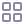
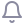
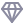
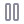
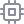

# EakUI Icons

EakUI ships **91 built-in icons** that you can use by name anywhere an image is accepted.

```lua
Window:Tab({ Title = "Settings", Icon = "settings" })
Tab:Button({ Title = "Teleport", Icon = "map-pin" })
Tab:Toggle({ Title = "God Mode", Icon = "shield" })
UI:Notify({ Title = "Saved", Icon = "check-circle" })
```

## How it works

- Icons are white line icons on a 24px grid (Lucide style). Element and tab icons are tinted by the theme automatically.
- The first time an icon is used, it is downloaded from this repository into `workspace/EakUI/assets/` and reused after that.
- This needs an executor with `writefile` and `getcustomasset`, which is the same requirement as URL images.
- Asset IDs (`rbxassetid://...`), URLs and workspace files still work exactly as before.
- `UI:GetIcons()` returns every name grouped by category.
- `UI:SetIconBaseUrl(url)` loads icons from your own host instead of this repository.
- `UI:Preload({ "settings", "sword" })` downloads icons ahead of time so they appear instantly.

## Names are case-insensitive

`"Settings"`, `"settings"` and `"SETTINGS"` all work. Spaces and underscores become dashes, so `"map pin"` and `"map_pin"` both resolve to `"map-pin"`.

## Icons

### Interface (19)

|   |   |   |   |   |   |
|---|---|---|---|---|---|
| <br>`home` | <br>`settings` | <br>`sliders` | <br>`menu` | <br>`search` | <br>`x` |
| <br>`check` | <br>`plus` | <br>`minus` | <br>`chevron-right` | <br>`chevron-down` | <br>`arrow-left` |
| <br>`arrow-right` | <br>`external-link` | <br>`refresh` | <br>`filter` | <br>`grid` | <br>`list` |
| <br>`more` |   |   |   |   |   |

### User & Security (14)

|   |   |   |   |   |   |
|---|---|---|---|---|---|
| <br>`user` | <br>`users` | <br>`user-plus` | <br>`crown` | <br>`shield` | <br>`shield-check` |
| <br>`lock` | <br>`unlock` | <br>`key` | <br>`eye` | <br>`eye-off` | <br>`bell` |
| <br>`star` | <br>`heart` |   |   |   |   |

### Combat & Game (13)

|   |   |   |   |   |   |
|---|---|---|---|---|---|
| <br>`sword` | <br>`crosshair` | <br>`target` | <br>`zap` | <br>`flame` | <br>`skull` |
| <br>`bomb` | <br>`trophy` | <br>`gem` | <br>`coins` | <br>`gift` | <br>`package` |
| <br>`rocket` |   |   |   |   |   |

### World & Movement (9)

|   |   |   |   |   |   |
|---|---|---|---|---|---|
| <br>`map` | <br>`map-pin` | <br>`compass` | <br>`navigation` | <br>`globe` | <br>`mountain` |
| <br>`sun` | <br>`moon` | <br>`cloud` |   |   |   |

### Actions (14)

|   |   |   |   |   |   |
|---|---|---|---|---|---|
| <br>`play` | <br>`pause` | <br>`stop` | <br>`save` | <br>`download` | <br>`upload` |
| <br>`trash` | <br>`copy` | <br>`edit` | <br>`send` | <br>`link` | <br>`log-out` |
| <br>`power` | <br>`undo` |   |   |   |   |

### Info & System (22)

|   |   |   |   |   |   |
|---|---|---|---|---|---|
| <br>`info` | <br>`alert` | <br>`help` | <br>`check-circle` | <br>`x-circle` | <br>`clock` |
| <br>`calendar` | <br>`bar-chart` | <br>`activity` | <br>`terminal` | <br>`code` | <br>`cpu` |
| <br>`wifi` | <br>`monitor` | <br>`smartphone` | <br>`keyboard` | <br>`mouse-pointer` | <br>`camera` |
| <br>`image` | <br>`music` | <br>`volume` | <br>`message` |   |   |

## Aliases

Common alternative names map to the icons above:

| Alias | Icon |
|---|---|
| `aim` | `crosshair` |
| `alert-triangle` | `alert` |
| `chart` | `bar-chart` |
| `chat` | `message` |
| `close` | `x` |
| `cog` | `settings` |
| `ellipsis` | `more` |
| `exit` | `log-out` |
| `fire` | `flame` |
| `flash` | `zap` |
| `gear` | `settings` |
| `hamburger` | `menu` |
| `help-circle` | `help` |
| `home-2` | `home` |
| `house` | `home` |
| `lightning` | `zap` |
| `location` | `map-pin` |
| `pc` | `monitor` |
| `pencil` | `edit` |
| `phone` | `smartphone` |
| `pin` | `map-pin` |
| `player` | `user` |
| `players` | `users` |
| `question` | `help` |
| `reset` | `undo` |
| `sound` | `volume` |
| `star-filled` | `star` |
| `teleport` | `navigation` |
| `trash-2` | `trash` |
| `warning` | `alert` |

## Adding an icon

1. Add an entry to `tools/icons/icons.json` with a `name`, a `category` and `paths` (SVG path data on a 24x24 grid, stroke only).
2. Run `python tools/build_icons.py`. This regenerates the PNGs, SVGs, `src/Core/IconList.lua` and this file.
3. Run `python tools/build.py`, then publish with `tools/publish.bat`.

## License

The icon designs follow the [Lucide](https://lucide.dev) style; Lucide is ISC licensed.
